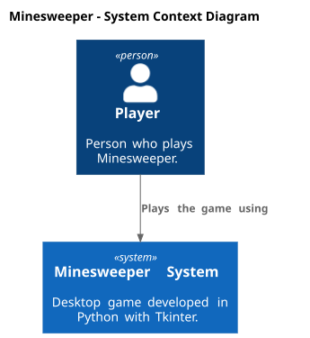

# 03 - System Scope and Context

## System Boundary

The Minesweeper system is a self-contained desktop application. Everything
required to run the game — the graphical interface, the game rules, and the
board calculations — lives inside a single process on the player's machine.

The system boundary encloses:

- the Tkinter-based graphical interface,
- the game logic that processes player moves and determines win or loss, and
- the board management that maintains the grid and calculates adjacent mine counts.

Nothing crosses that boundary at runtime. There is no network connection,
no external service, no file system persistence, and no database.

---

## External Actors

The only external actor is the **Player**: a person who launches the application
and interacts with it through the graphical interface.

| Actor | Type | Interaction |
|-------|------|-------------|
| Player | Human | Launches the application, reveals cells by left-clicking, flags suspected mines by right-clicking, and starts new games via the interface. |

No other systems, services, or actors interact with the Minesweeper application.

---

## Why No External Systems Are Involved

The project scope, established in Chapter 1 and constrained in Chapter 2
(TC-3, TC-6, SC-4), rules out all external dependencies:

- **No server or network** — the application runs entirely on the local desktop.
- **No database or file persistence** — game state exists only in memory for
  the duration of a session. Scores and history are not stored.
- **No third-party services** — Tkinter is bundled with standard Python
  installations. No additional runtime dependencies are needed.

This keeps the deployment model trivial: install Python, run the application.

---

## C4 System Context Diagram

The diagram below shows the system boundary and the single external actor.

> Source: [`architecture/diagrams/c4-context.puml`](diagrams/c4-context.puml)

The Player interacts with the Minesweeper System directly through the desktop
interface. No other relationships exist at the system context level.
