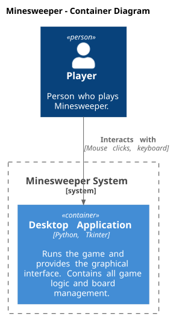
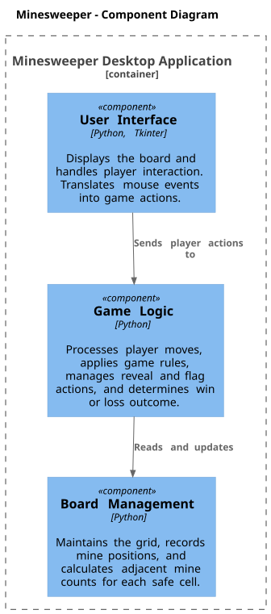

# 05 - Building Block View

## Overview

The Minesweeper application is a single Python process. At the container
level there is one deployable unit: the Desktop Application. Inside that
unit, three components carry the three main responsibilities established in
ADR-001 — Board Management, Game Logic, and User Interface.

The dependency direction is strictly one-way:

```
User Interface → Game Logic → Board Management
```

Neither Game Logic nor Board Management has any knowledge of Tkinter or the
UI layer. This keeps both logic components independently testable.

---

## C4 Container Diagram

The container diagram shows the single runtime unit and its relationship to
the Player.



> Source: [`architecture/diagrams/c4-container.puml`](diagrams/c4-container.puml)

There is one container: the Python/Tkinter Desktop Application. It runs
locally on the player's machine and contains all game logic and board
management. No other containers, servers, or external services exist.

---

## C4 Component Diagram

The component diagram zooms into the Desktop Application and shows how the
three responsibilities are separated.



> Source: [`architecture/diagrams/c4-component.puml`](diagrams/c4-component.puml)

---

## Component Descriptions

### User Interface

| Attribute | Detail |
|-----------|--------|
| Technology | Python, Tkinter |
| Responsibility | Renders the current board state as a grid of cells. Handles mouse events (left-click to reveal, right-click to flag) and translates them into calls to Game Logic. Displays win and loss outcomes and offers a new-game action. |
| Dependencies | Depends on Game Logic. Has no direct dependency on Board Management. |
| Testability | Requires a running desktop environment. Not covered by headless unit tests. |

### Game Logic

| Attribute | Detail |
|-----------|--------|
| Technology | Python (no Tkinter) |
| Responsibility | Receives player actions from the UI (reveal cell, flag cell, new game). Applies game rules: triggers cascade reveal when a cell has zero adjacent mines, determines win when all safe cells are revealed, determines loss when a mine cell is revealed. Maintains the current game state. |
| Dependencies | Depends on Board Management to read cell data and mine positions. |
| Testability | Fully testable without a GUI. Unit tests can supply a Board directly and assert on game state. |

### Board Management

| Attribute | Detail |
|-----------|--------|
| Technology | Python (no Tkinter) |
| Responsibility | Holds the grid of cells, records mine positions, and calculates the adjacent mine count for every safe cell. This is the direct implementation of the Coding Dojo Minesweeper kata algorithm. |
| Dependencies | None. Has no dependency on Game Logic or the UI. |
| Testability | Fully testable in isolation. The kata algorithm can be verified with simple grid fixtures. |

---

## Relationships and Dependency Directions

| From | To | Interaction |
|------|----|-------------|
| User Interface | Game Logic | Sends player actions (reveal, flag, new game). Reads game state to update the display. |
| Game Logic | Board Management | Reads cell data, mine positions, and adjacent mine counts. Updates cell state (revealed, flagged) as moves are processed. |

The User Interface never reads from Board Management directly. All board
state is mediated through Game Logic. This keeps the UI decoupled from the
grid representation and allows the board data model to change without
affecting the UI layer.

---

## Testability and Maintainability

**Testability** — Board Management and Game Logic are plain Python modules
with no Tkinter imports (TC-4). A test runner such as pytest can exercise
them without opening any window. The UI is the only component that cannot
be unit-tested headlessly, and its logic is kept thin for this reason:
it translates events and renders state; it does not contain game rules.

**Maintainability** — Each component owns exactly one concern. The
interfaces between them are narrow (a small set of method calls). A change
to the board's internal grid representation does not affect the UI. A change
to the win condition in Game Logic does not affect Board Management. This
locality of change is the practical benefit of the three-responsibility
separation required by SC-3.
