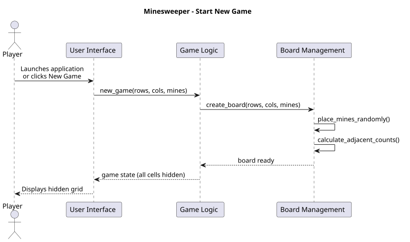
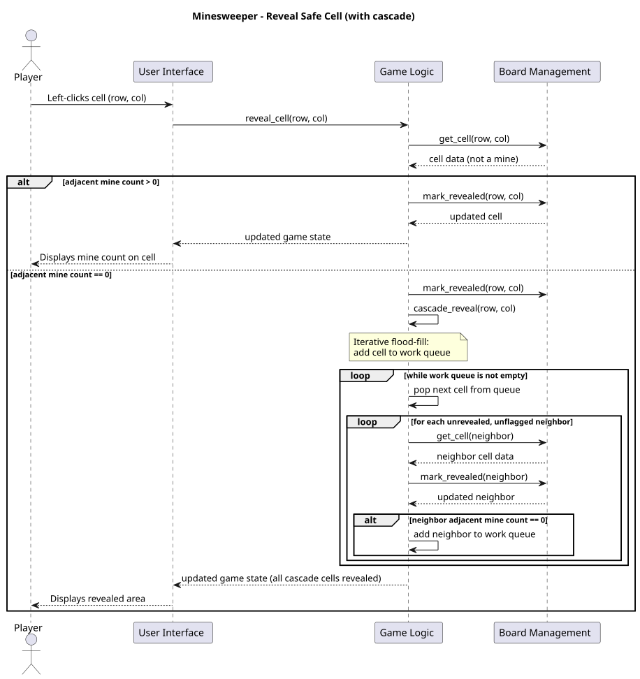
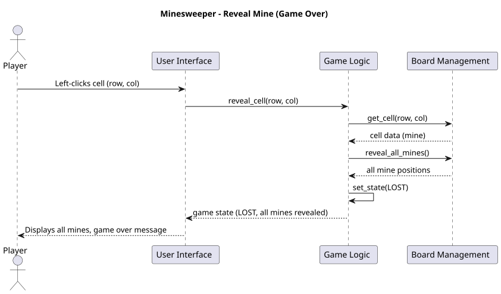
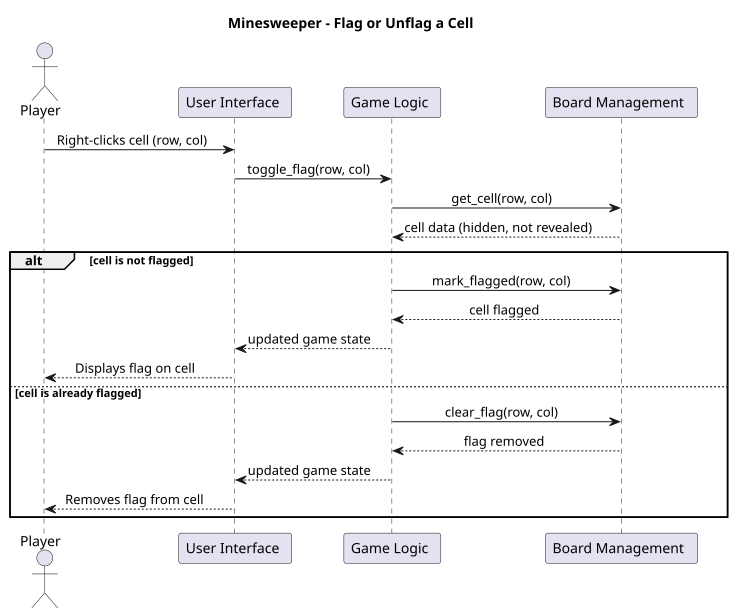

# 06 - Runtime View

The runtime view describes how the three components — User Interface, Game
Logic, and Board Management — interact during the key scenarios of a
Minesweeper session. All interactions follow the dependency direction
established in Chapter 5:

```
User Interface → Game Logic → Board Management
```

The UI never calls Board Management directly. All board state flows through
Game Logic.

---

## Scenario 1: Starting a New Game

The player launches the application or clicks a New Game button. The UI
asks Game Logic to initialise a new game with the chosen grid dimensions
and mine count. Game Logic delegates board creation to Board Management,
which places mines randomly and calculates adjacent mine counts for every
safe cell. Once the board is ready, Game Logic returns the initial game
state to the UI, which renders a fully hidden grid.



> Source: [`architecture/diagrams/seq-new-game.puml`](diagrams/seq-new-game.puml)

---

## Scenario 2: Revealing a Safe Cell

The player left-clicks a cell. The UI passes the cell coordinates to Game
Logic. Game Logic asks Board Management for the cell data and confirms the
cell is not a mine.

**If the adjacent mine count is greater than zero**, Game Logic marks the
cell as revealed and returns the updated state. The UI displays the mine
count on that cell.

**If the adjacent mine count is zero**, Game Logic performs a cascade
reveal: it iterates over all unrevealed, unflagged neighbours, marks each
one revealed, and repeats for any neighbour that also has a zero count. The
full set of newly revealed cells is returned to the UI in one update.



> Source: [`architecture/diagrams/seq-reveal-safe.puml`](diagrams/seq-reveal-safe.puml)

---

## Scenario 3: Revealing a Mine — Game Over

The player left-clicks a cell that contains a mine. Game Logic detects this
from the cell data returned by Board Management, asks Board Management to
expose all mine positions, sets the game state to LOST, and returns the
updated state to the UI. The UI reveals all mines on the board and displays
a game-over message. No further reveal or flag actions are accepted.



> Source: [`architecture/diagrams/seq-reveal-mine.puml`](diagrams/seq-reveal-mine.puml)

---

## Scenario 4: Flagging or Unflagging a Cell

The player right-clicks a hidden cell to mark it as a suspected mine, or
right-clicks an already-flagged cell to remove the flag. The UI passes the
coordinates to Game Logic as a toggle action. Game Logic reads the current
cell state from Board Management and either sets or clears the flag
accordingly. The updated state is returned to the UI, which refreshes the
cell's appearance.

Flagging does not affect the win or loss check. A flagged cell cannot be
revealed until the flag is removed.



> Source: [`architecture/diagrams/seq-flag-cell.puml`](diagrams/seq-flag-cell.puml)

---

## Notes on the Runtime Model

- All four scenarios run synchronously within a single Python process. There
  are no background threads or asynchronous calls.
- The UI re-renders only after Game Logic returns an updated game state. It
  does not poll Board Management independently.
- The cascade reveal in Scenario 2 is handled entirely inside Game Logic.
  The UI receives the final set of revealed cells as a single state update,
  not as a series of incremental updates.
